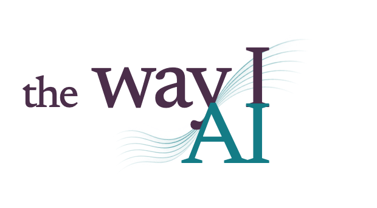

<p><strong><a href="https://thewayiai.com/">Read The Way I AI →</a></strong></p>

<h1 align="center">
  <picture>
    <source media="(prefers-color-scheme: dark)" srcset="topics/assets/readme-logo-dark.png">
    <source media="(prefers-color-scheme: light)" srcset="topics/assets/readme-logo-light.png">
    
  </picture>
</h1>

<p align="center">
  <strong>Practical ideas for working with AI.</strong><br>
  Workflows, mental models, and ways to organize AI systems in real life.
</p>

<p align="center">
  <a href="https://github.com/tkarakai/the-way-i-ai/actions/workflows/pages.yml"></a>
  <a href="https://thewayiai.com/"></a>
  <a href="#editing-and-adding-topics-notes-to-self"></a>
</p>

<p align="center"><strong><a href="https://thewayiai.com/">Explore the interactive collection →</a></strong></p>

Subscribe to new topics in your feed reader with the [RSS feed](https://thewayiai.com/feed.xml).

---

## About the collection

Each topic has authoritative source documents and assets, plus a complete, interactive HTML edition. Start with the [live collection](https://thewayiai.com/), or choose a topic below.

| Topic | Idea | Markdown | Interactive edition |
| --- | --- | --- | --- |
| **01 · Git Worktrees for Claude Code** | Give every development task its own branch, working directory, and AI session. | [Tools and setup](topics/worktrees/README.md) · [Workflow](topics/worktrees/WORKFLOW.md) | [Read online](https://thewayiai.com/topics/worktrees/) |
| **02 · A Framework for Defining AI Agent Roles in an Agentic Organization** | Define agents through professional context, operational capabilities, and discoverable profiles. | [Framework](topics/agent-roles/README.md) | [Read online](https://thewayiai.com/topics/agent-roles/) |
| **03 · A web app starter kit built for the long run** | Architect the starter to stay useful when downstream applications replace its design, without making future improvements undo their product choices. | [The architecture](topics/web-app-starter-kit/README.md) · [Original notes](topics/web-app-starter-kit/web_app_starter_upgrade_notes.md) | [Read online](https://thewayiai.com/topics/web-app-starter-kit/) |
| **04 · Just Enough Context (JEC)** | Give specialist agents focused context and humans small, timely decisions, backed by reusable project knowledge. | [The concept](topics/just-enough-context/README.md) | [Read online](https://thewayiai.com/topics/just-enough-context/) |

## About this repository

This is a personal publication, not a template or a product. I keep the repository public so the ideas and the way they are presented can be seen together: the Markdown sources, the small generator that turns them into the site, and the design system behind both designs are all here to read.

It is not meant to be cloned or forked and run as-is. The generator, checks, and design system are shaped around this one collection: its two designs, its artwork, its domain, and whatever I changed my mind about last week. If you want to build something similar, start a new repository of your own and borrow only the ideas that help, such as Markdown as the single source of truth, static pages with shared, cacheable assets, or sharing cards generated from the same sources.

Everything below about building, checking, previewing, and publishing is a set of notes to myself, and to the AI agents that help me maintain the site. The notes are accurate for my setup, but they are not a supported way for anyone else to run it.

Reuse terms are on the [licensing page](https://thewayiai.com/licensing/index.html): the articles are CC BY-NC 4.0, the code is MIT, and the illustrations and branding are not offered for reuse.

## Sources and presentation

*Notes to self from here on.* This repository is a small static-site generator. Its source of truth is **Markdown (including YAML front matter) + authored assets**. HTML is generated from those sources; it contains no independently maintained ideas.

```text
AGENTS.md                      Primary guide for maintaining content and presentation
CLAUDE.md                      Points to AGENTS.md
README.md                      Collection overview and maintenance notes
package.json                   Build commands and development dependencies
package-lock.json              Pinned dependency tree
topics/
  topics.json                  Collection copy and ordered list of topic IDs
  worktrees/
    README.md                  Topic metadata, document order, tools, and setup
    WORKFLOW.md                Development and review workflow
    assets/illustrations/      Optional generated images and placement manifest
    worktree-new.sh             wwt tool
    worktree-done.sh            wwtd tool
  agent-roles/
    README.md                  Topic metadata, complete role framework, and excerpts
    assets/illustrations/      Optional generated images and placement manifest
  web-app-starter-kit/
    README.md                  Topic metadata and long-lived starter architecture
    web_app_starter_upgrade_notes.md  Original notes, preserved unchanged
    assets/illustrations/      Optional generated images and placement manifest
  just-enough-context/
    README.md                  Topic metadata and complete JEC article
    assets/illustrations/      Optional generated images and placement manifest
design-system/                Shared visual language and generic reader components
scripts/                       Generator and contract checks
.github/workflows/pages.yml    GitHub Pages build and deployment
_site/                         Generated publication bundle (ignored by Git)
```

Topic illustration folders are optional and may not exist until artwork is delivered. See the [AI image delivery guide](design-system/illustration-style/README.md) for exact filenames, chapter bindings, and a ready-to-extract ZIP contract. Missing images display nothing; homepage illustration blocks stay empty. Use the [wildlife generation prompt](design-system/illustration-style/single-topic-illustration-prompt.md) with an animal species and attached reference images (any number, at least one); extract its ZIP directly into the chosen topic's illustration folder. No topic research or chapter mapping is needed. This is the sole generation prompt.

Diagrams, when authored, are content: their SVG sources live with their topic, where their labels and relationships can be reviewed. Interactive panels reuse sections or named excerpts from Markdown. Short labels and bindings live in the main README's YAML front matter. Shared components arrange these sources without knowing which topic they represent.

## Reading offline

Read the collection on the [live site](https://thewayiai.com/). The publication is a folder of small HTML pages and shared local assets. The former single-file edition is retired to reduce mobile data use. Download a workflow preview artifact, unzip it, and serve the folder locally (for example, run `npx serve` inside it). Once a local server is available, reading, search, themes and navigation work without internet access. Keep the complete folder; an isolated HTML file no longer includes its fonts, scripts or artwork.

GitHub's repository file viewer shows HTML source; the [live site](https://thewayiai.com/) serves the interactive edition. Documentation links lead to that live site, while navigation inside the generated HTML stays relative for both hosted and local reading. The rendered pages contain no links to raw Markdown; source documents remain available in the repository.

The site has two designs, switched with Atlas/Folio at the top right. **Field Atlas**, the default, presents each topic with its wildlife portrait mounted like a naturalist's illustration: browse the topics on the home page with the arrows or ← →, open “All topics” from the header, follow the running head as you read, and go to the previous or next topic with `[` and `]`. An A–Z index, linked from every footer, lists every chapter. Your choice is remembered, and switching keeps your place.

The Folio edition includes local collection-wide search (⌘/Ctrl+K), section search (`/`), an expandable collection sidebar, and optional visual guides. Topic headers compact while you scroll. Use the header’s “Focus on reading” icon to hide navigation, then “Show navigation” or Escape to restore it. On desktop, drag the column boundaries or focus their resize handles and use Left/Right arrows to adjust the navigation and reading widths. When browser storage is available, the site remembers those widths, focus mode, and whether you opened the initially collapsed collection sidebar. It also restores each topic’s reading position unless you follow a link to a specific section.

The icon next to GitHub switches directly to the opposite theme: a moon for Dark, a sun for Light. System is the default and follows device changes; a manual choice resets to System after two hours without scrolling, typing, or navigation. All text is readable without JavaScript.

In both designs, the header’s share icon (on phones, the button at the end of a topic) shows the page’s sharing card with its link to copy, the device’s share sheet where there is one, and email and social links. Dates read as how long ago, to the month; hover or tap one for the exact date. Press `?` for the keyboard shortcuts.

## Editing and adding topics (notes to self)

Use Node.js 24 or newer for building. Node.js and npm are not needed for reading.

Topic dates are authored in the main README's optional `created` and `updated` front-matter fields, not derived from Git history or the build clock. Authored dates survive squash merges and source archives unchanged. A separate build edition records the UTC build date and source revision. Set `SOURCE_DATE_EPOCH` and `GITHUB_SHA` to reproduce a specific edition. See the [date metadata contract](design-system/README.md#build-contract).

```sh
npm ci
npm run typecheck
npm run build
npm run check
npx playwright install chromium # First checkout: sharing-card renderer and browser tests
npm test
```

For browser acceptance tests (also run before deployment):

```sh
npm run test:browser
```

These tests build `_site/` and exercise pages served locally without external network access, narrow layouts, keyboard controls, themes, sidebar behavior, and header scrolling. Screenshots and failure traces are written to the ignored `test-results/` directory.

`package.json` defines these commands and the development-only dependencies: TypeScript checking/compilation, Markdown parsing, code rendering, fonts, and Playwright tests. `package-lock.json` makes installation reproducible.

To add a topic:

1. Create `topics/<id>/README.md` with YAML front matter (`category`, `description`, `thesis`) followed by a single `#` title. Use `##` chapters and `###` subsections. For multiple documents, list their paths under `documents`, beginning with `README.md`.
2. Append the folder ID to the `topics` array in `topics/topics.json`. The homepage displays newest-added topics first; numbering and reader navigation retain canonical order.
3. Add optional diagrams/images in `assets/`. Bind a visual explorer to Markdown sections or named excerpts when useful.
4. Run the commands above, inspect the generated pages, and update this README's topic list.

See [AGENTS.md](AGENTS.md) for the complete authoring contract, examples, and verification process. It applies to agents maintaining both the ideas and their presentation. See the [design system](design-system/README.md) for shared visual components.

Worktree installation paths changed when the topic moved. Existing shell functions should now source `topics/worktrees/worktree-new.sh` and `topics/worktrees/worktree-done.sh`; the topic's installation examples show the full commands.

## Previewing an in-progress branch (notes to self)

```sh
npm run preview
```

Install Playwright Chromium first with `npx playwright install chromium`. Publication builds automatically render the social sharing images from the current titles, artwork, and shared card design; local builds without sharing-card rasterization and output checks do not require a browser.

This builds the current checkout into `_site/` and serves it at the local URL printed in the terminal (normally `http://127.0.0.1:4173/`). If another worktree is using that port, the server chooses an available one. After editing, run `npm run build:site` in another terminal and refresh the browser. This full-site preview uses the publication content and theme.

Every pull request also produces a **site-preview-pr-N** artifact in its **Publish collection** workflow run. Follow the download link in the run summary, unzip the artifact, and serve its folder over HTTP (for example, with `npx serve`). The artifact includes the complete offline site and supporting source files, expires after 14 days, and does not change the public Pages site.

## Publishing to GitHub Pages (notes to self)

The collection is published at **[thewayiai.com](https://thewayiai.com/)**. GitHub Pages is configured to deploy through GitHub Actions. The [included workflow](.github/workflows/pages.yml) runs the checks described in [Editing and adding topics](#editing-and-adding-topics-notes-to-self), including browser acceptance tests, before deploying the clean `_site/` bundle. It does not publish the repository root or build dependencies.

To prepare the publication bundle locally:

```sh
npm run build:site
```

This recreates `_site/` from the same sources, including supporting topic files. Use `npm run preview` to inspect it over HTTP. Generated HTML, shared assets, feeds and icons are ignored by Git; the workflow uploads the deployment artifact directly to Pages. Old generated files remain in Git history, which is not rewritten.

Pull requests run the same checks and build, without deployment. Pushes to `main` and manual runs of **Publish collection** from `main` deploy after checks pass. Local builds and branch previews do not publish the current branch.

See [Reading offline](#reading-offline) for navigation behavior and [AGENTS.md](AGENTS.md#building-and-publishing) for the link-authoring contract.

Reference: [GitHub's custom Pages workflow guide](https://docs.github.com/en/pages/getting-started-with-github-pages/using-custom-workflows-with-github-pages).

Architecture, configuration, build, deployment, monitoring and recovery are in [the operations SOP](docs/operations.md). Reusable per-project setup and acceptance steps are in [the operational readiness checklist](docs/operational-readiness.md). Agents can start at [llms.txt](https://thewayiai.com/llms.txt); complete Markdown editions are published beside each topic as `index.md`.

Report security vulnerabilities through the [repository's Security page](https://github.com/tkarakai/the-way-i-ai/security) using **Report a vulnerability**. Reports are private and require a GitHub account and sign-in. See [SECURITY.md](SECURITY.md) for the policy.
