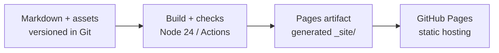

# Publication operations SOP

Architecture, configuration, build, deployment, monitoring and recovery procedures for The Way I AI.

The [operational readiness checklist](operational-readiness.md) provides per-project setup and acceptance steps. Keep account-setting snapshots and execution evidence in a private project record. GoatCounter and Cloudflare Web Analytics measure readership and performance once their identifiers are configured; see [visit statistics](#visit-statistics-goatcounter-and-cloudflare-web-analytics) for setup, verification and monitoring. Google Search Console verification also remains outstanding.

## Architecture



The site is a static publication at **https://thewayiai.com/**. There is no application server, database, account system or runtime rendering service. GitHub Actions builds and validates the publication, uploads a Pages artifact, and deploys that artifact. GitHub Pages does not require generated HTML in the repository.

| Component | Responsibility |
| --- | --- |
| `topics/`, `pages/`, `design-system/` | Authoritative articles, assets, collection metadata and presentation sources. |
| `scripts/` and the pinned npm lockfile | TypeScript generator, validation, image conversion and tests on Node.js 24. |
| `_site/` | Ignored, generated publication bundle. Never author or commit here. |
| `.github/workflows/pages.yml` | Validates PRs, uploads preview artifacts and deploys successful `main` builds. |
| GitHub Pages | Serves the uploaded static files over HTTPS on the apex domain. |
| Cloudflare DNS | Resolves the domain to GitHub Pages. Cloudflare Web Analytics does not require proxying or changing hosting. |

HTML carries complete article text. CSS, JavaScript, fonts, the search index and images are shared local files. Raster artwork has WebP variants from 320 to 1600 pixels, bounded by source size; navigation portraits are capped at 360 pixels. Search loads its index on demand. Content-addressed asset filenames allow reuse without stale asset collisions; GitHub Pages controls the response cache headers.

Downloaded bundles need the whole folder and a local HTTP server for full functionality. Generated site and preview HTML stay out of Git.

## Domain and hosting configuration

The canonical hostname is `thewayiai.com`, without `www`. Canonical page addresses end in `/`; internal HTML navigation uses relative, explicit `index.html` paths so a repository subpath or downloaded bundle retains native navigation.

Cloudflare is authoritative through `max.ns.cloudflare.com` and `tia.ns.cloudflare.com`. The apex currently has the four GitHub Pages IPv4 addresses:

```text
185.199.108.153
185.199.109.153
185.199.110.153
185.199.111.153
```

Keep the records DNS-only for the present architecture. There is no `www` record. Retain ownership-verification TXT records for GitHub and Google once configured. Obtain new verification values from the relevant account; they are not interchangeable. If changing Pages addresses, consult [GitHub's DNS instructions](https://docs.github.com/en/pages/configuring-a-custom-domain-for-your-github-pages-site/managing-a-custom-domain-for-your-github-pages-site).

In repository **Settings → Pages**, the publishing source is **GitHub Actions**, the custom domain is `thewayiai.com`, and **Enforce HTTPS** is enabled. The certificate covers the apex domain.

## GitHub operating controls

The repository's existing branch protection applies to `main`, includes administrators, requires linear history, and disallows force pushes and branch deletion. The `github-pages` deployment environment allows only the `main` branch. The default Actions token is read-only and cannot approve pull requests; only the deployment job requests `pages: write` and `id-token: write`.

Merge through a PR after the **build** job succeeds. Automatic enforcement of that check, fork-workflow approval for all external contributors, the Actions allowlist/SHA policy, and dependency/security reporting settings are tracked individually in the [GitHub readiness tasks](operational-readiness.md#github-settings).

Actions are pinned to full commit SHAs in source, with release comments for readability. The Pages-upload action also pins its nested upload action. Checkout does not persist credentials and does not fetch full history. `.github/dependabot.yml` defines weekly updates for Actions and npm; repository-level vulnerability alerts and security updates are separate settings.

For a solo maintainer, PRs and passing checks are still required operating practice. An independent human approval policy needs an available second reviewer: GitHub does not let an author approve their own PR. Record that policy explicitly rather than enabling a requirement that cannot be met. Do not require a successful production Pages deployment before merging: this workflow deploys only after a change reaches `main`.

## Local build and validation

Use Node.js 24. On a fresh checkout or lockfile change, install the exact dependency tree. Install Playwright Chromium before publication or browser tests:

```sh
npm ci
npx playwright install chromium
npm run typecheck
npm test
npm run build:site
npm run check
npm run test:browser
```

| Command | Result |
| --- | --- |
| `npm run build` | Generates `_site/` without rasterizing sharing JPEGs. |
| `npm run build:site` | Generates the full bundle, including sharing JPEGs; needs Chromium. |
| `npm run check` | Validates sources, links and references. If `_site/version.json` exists, also checks generated files against that recorded edition. It does not write output. |
| `npm run test:browser` | Builds the publication and background preview, then exercises both designs and their interactions. |
| `npm run dev` | Serves the current checkout locally, normally on port 4173, rebuilding on source changes and reloading open pages. Skips sharing JPEGs unless run as `npm run dev -- --site`. |

While editing, keep `npm run dev` running; it rebuilds and reloads after each save and shows build errors in the page. Use `npm run dev -- --site` to inspect sharing images. Inspect affected pages at desktop and 320/390px widths in light and dark modes. Check keyboard controls, full text, no-JavaScript content and relevant interactions. Generated output is staged only after source validation succeeds; do not repair a failed build by editing `_site/`.

A PR workflow uploads `site-preview-pr-N`, retained for 14 days and linked in the run summary. Download and unzip it, then serve that folder over HTTP, for example with `npx serve`. A PR preview does not deploy the public site.

## Deployment and post-deployment verification

1. Review the source diff and successful PR **build** check. Inspect the downloaded preview where presentation or behavior changed.
2. Merge the PR into `main`. Pushes to `main`, or manual dispatch of **Publish collection** on `main`, build and deploy through the `github-pages` environment. Local builds do not publish.
3. Confirm both **build** and **deploy** succeed in the [workflow run](https://github.com/tkarakai/the-way-i-ai/actions/workflows/pages.yml). Record its URL and resulting source revision in the private project record for a readiness rollout, or in the PR for routine changes.
4. Open the live homepage and a topic. Check `/version.json` against the deployed `main` revision and confirm the footer edition agrees. Allow for hosting caches when checking propagation.
5. Verify HTTPS, theme/design switching, search, images and a code example. Confirm an unknown nested path returns the generated 404 page with HTTP 404.
6. Check `/feed.xml`, `/sitemap.xml`, `/llms.txt`, `/llms-full.txt`, a topic's `index.md`, and `/.well-known/security.txt`. Check their content, not only an HTTP 200 response.
7. Where analytics have been activated, verify both services independently as described below. Finish only after recording any discrepancies and their follow-up.

Never deploy a PR preview artifact as production or manually alter the generated Pages files. The reviewed source and workflow remain the route to a reproducible deployment.

## Editions and incident traceability

A footer edition has the form `YYYY.MM.DD.HHMM+commit`, using UTC build date/time and the short source revision. Tracked local changes add `.local`. `/version.json` records the full revision and exact build timestamp. These describe the build, not the articles' publication dates.

For a bug report, collect the URL, edition, design/theme, browser/device, reproduction steps and relevant console/network errors. Check the matching workflow and source revision. There is currently no automatic production JavaScript-error collection.

To reproduce an edition, use the same sources, lockfile and Node/dependency versions. Set `SOURCE_DATE_EPOCH` to the recorded build timestamp in seconds and `GITHUB_SHA` to the recorded full revision. A `.local` edition also requires its uncommitted changes. Article dates come exclusively from front matter and never from the build clock or Git history.

## Monitoring and recurring checks

Current coverage consists of CI checks, manual live-site inspection and, once configured, the two visit-statistics dashboards. Search-console access and notification-delivery verification remain setup work in the readiness checklist. No unattended uptime checker or browser-error service is currently configured.

| Signal | Purpose and recurring use | Current integration state |
| --- | --- | --- |
| GitHub Actions | Build/test/deploy failures and the exact source revision behind a release. Review every deployment and failed run. | Workflow present; notification delivery still needs verification. |
| GoatCounter | Readership, popular pages, referrers and broken inbound links. Review weekly. | Integration built; active once the `GOATCOUNTER_CODE` repository variable is set and verified. |
| Cloudflare Web Analytics | Real-user page-load performance and Core Web Vitals. Review weekly, especially mobile performance. | Integration built; active once the `CLOUDFLARE_WEB_ANALYTICS_TOKEN` repository variable is set and verified. |
| Google Search Console | Indexing errors, impressions, clicks and queries. Review monthly after verification. | Verification pending. |
| Manual live-site check | Availability, HTTPS/certificate, navigation, content, machine-readable files and displayed edition. | Run after deployments and weekly. |

For weekly operations, inspect the workflow/security inbox, review Dependabot PRs, run the manual site check, and review both analytics dashboards once active. For monthly operations, inspect search-indexing reports and the domain/certificate settings. Check `security.txt` expiry monthly and rebuild before it expires; the generated expiry is 180 days after the build. No automatic renewal schedule is configured.

Configure and verify delivery of Actions failures and security alerts to the maintainer's chosen inbox. GitHub's built-in Actions notifications cover runs the user triggers; do not assume they prove delivery for every other actor's run. See [workflow notifications](https://docs.github.com/en/actions/concepts/workflows-and-actions/notifications-for-workflow-runs). Record the test evidence before relying on them.

## Visit statistics: GoatCounter and Cloudflare Web Analytics

Two cookieless services measure the published site. Each has its own job:

- **GoatCounter** counts readership: page views, popular pages, referring sites and broken inbound links.
- **Cloudflare Web Analytics** measures performance: real visitors' loading times and Core Web Vitals.

Do not add their counts together. Content blockers and different measuring methods mean the totals differ. Neither counts people exactly or monitors availability. [Cloudflare Web Analytics](https://developers.cloudflare.com/web-analytics/about/) measures in the browser; it is not a server request log.

### How the integration works

The provider identifiers are deployment settings, so they are not stored in Git. The build reads them from environment variables, and the Pages workflow fills those from GitHub repository variables:

| Repository variable | Value |
| --- | --- |
| `GOATCOUNTER_CODE` | The site code from `https://CODE.goatcounter.com` |
| `CLOUDFLARE_WEB_ANALYTICS_TOKEN` | The 32-character `token` from the Web Analytics snippet |

Both values are public identifiers, not credentials: every published page carries them, and anyone can see them with View Source. Store them as **variables**, not secrets, so they stay visible and editable. Either can be left out.

These builds publish without statistics because they have no variables:

- local checkouts and `npm run dev`;
- forks, which do not inherit repository variables;
- PR runs from forks.

To test a build with statistics locally, set the variables for one command, for example `GOATCOUNTER_CODE=example npm run build`. Local pages still never count.

When a variable is set, the build does three things:

- It appends `design-system/analytics.ts` to the shared reader script.
- It writes the identifiers into each page as JSON (`#analytics-config`).
- It adds each configured provider's endpoint to the Content Security Policy: GoatCounter's `/count` pixel under `img-src`, Cloudflare's `static.cloudflareinsights.com` under `script-src` and `cloudflareinsights.com` under `connect-src`.

The build fails with an explanation in four cases:

- A value is malformed.
- `topics/topics.json` contains an `analytics` field. The identifiers belong in the variables.
- A variable is set but `pages/privacy.md` does not name that provider ("GoatCounter", "Cloudflare Web Analytics").
- A deployment from `main` (the workflow sets `ANALYTICS_REQUIRED=true`) lacks a variable for a provider that the privacy page names. A merge can therefore never publish a privacy page that describes statistics the site doesn't collect.

Never paste a provider snippet into a page, an article or a template.

Reproducing a build (see [editions](#editions-and-incident-traceability)) also needs the same two variables, because they change the generated pages.

The same bundle is deployed, previewed and downloaded, so the browser decides whether to count. Nothing loads or is sent in any of these cases:

- The page is not served over HTTPS from the `siteUrl` host. Local servers, PR preview artifacts, downloaded bundles and other hostnames never count.
- The page is inside a frame.
- The page was prerendered but never shown.
- The browser sends Global Privacy Control or Do Not Track.
- This browser has been switched off with the hidden toggle described next.

**The hidden toggle.** The site has no visible control for this. The privacy page documents it for readers, and the maintainer uses it to keep their own visits out.

- To switch a browser off, open `https://thewayiai.com/nocount`. The address also works as `/no-count`, `#nocount` or `#no-count`, in any letter case.
- To switch it back on, open `/count` or `#count`.

The choice is stored as `the-way-i-ai-analytics=off` in that browser profile's local storage for this site. It is per browser and per device, and clearing site data removes it.

The path forms arrive on the 404 page, which records the choice and returns to the home page with a confirmation message. The fragment forms work on any page and confirm in place. None of these loads is counted, including the confirming home page.

What each provider receives:

- **GoatCounter** gets one request per page view through its [documented pixel](https://www.goatcounter.com/help/pixel). No GoatCounter script runs. The request includes:
  - the canonical path (`p`), without a query or fragment;
  - the page title (`t`);
  - the referrer (`r`), only when it is another site, reduced to its origin and path;
  - the screen size (`s`);
  - `b=153` for WebDriver-controlled browsers, so GoatCounter files them as bots.

  The 404 page reports the missing path, titled "Nothing here".
- **Cloudflare** runs its beacon with `spa: false`, so rewriting the address in a topic's find box is not reported as a new page. The beacon is skipped when the page's address or a same-site referrer has a query, because the site puts search words in `?q=`.

Switching design or theme never reloads the page, so it never adds a count. Blocked or failing providers do not affect reading.

### 1. Set up GoatCounter

Labels below were current when this was written; the providers' screens can change.

1. Sign up at [goatcounter.com/signup](https://www.goatcounter.com/signup). The hosted service is free for reasonable public, non-commercial use.
2. Choose the **site code**. It becomes `https://CODE.goatcounter.com` and the value of `GOATCOUNTER_CODE`. Use lowercase letters, digits and dashes.
3. Enter the login email and a password. Confirm the email address. Keep the credentials in a password manager, never in the repository.
4. Open the dashboard at `https://CODE.goatcounter.com`. In **Settings**:
   - Set the site's domain to the production hostname (`thewayiai.com`). The dashboard uses it for links.
   - Under **Tracking**, use **Ignore IPs** to add the addresses you visit from (home, office). This adds to the hidden toggle, which also covers phones and travel.
   - Leave data collection at its defaults, including sessions. The privacy page describes that setup. If you turn on extra collection, update `pages/privacy.md` in the same change.
5. Skip the `count.js` snippet GoatCounter offers. The site sends GoatCounter's pixel request itself.

See the [GoatCounter privacy policy](https://www.goatcounter.com/privacy) for what it stores and where. When this was written: no IP addresses or full user agents are stored, servers are in Finland and Germany, and backups are kept for up to 30 days.

### 2. Set up Cloudflare Web Analytics

1. Sign in to the [Cloudflare dashboard](https://dash.cloudflare.com/) with the account that holds the domain's DNS zone. Any free account works.
2. Open **Analytics & Logs → Web Analytics** and choose **Add a site**.
3. Enter the hostname (`thewayiai.com`) and finish.

   The site's DNS records are DNS-only, so GitHub Pages serves the site directly. Choose the manual **JS snippet** setup. Do not turn on proxying or automatic setup to make Web Analytics work. See [Cloudflare's setup guide](https://developers.cloudflare.com/web-analytics/get-started/).
4. Under **Manage site**, copy the snippet. Take only the value of `"token"` in `data-cf-beacon='{"token": "…"}'`, a 32-character hexadecimal string. That is `CLOUDFLARE_WEB_ANALYTICS_TOKEN`. Do not paste the snippet anywhere.
5. Web Analytics rules (for example, excluding paths) are [only available for proxied sites](https://developers.cloudflare.com/web-analytics/configuration-options/rules/). Your own visits are excluded only by the hidden toggle.

Cloudflare [keeps unsampled beacon data for 7 days](https://developers.cloudflare.com/web-analytics/faq/), then about a 10% sample. The dashboard shows the previous six months.

### 3. Turn it on

1. In the repository, open **Settings → Secrets and variables → Actions → Variables**. Add `GOATCOUNTER_CODE` and `CLOUDFLARE_WEB_ANALYTICS_TOKEN` as **repository variables**.

   With the GitHub CLI: `gh variable set GOATCOUNTER_CODE --body CODE` and `gh variable set CLOUDFLARE_WEB_ANALYTICS_TOKEN --body TOKEN`.
2. Make sure `pages/privacy.md` describes exactly the configured providers: what each receives, why, where it is processed, links to their policies, and how to opt out. This repository's privacy page already does.

   A fork must write its own. If you remove a provider, remove its paragraph in the same change, or the deployment fails.
3. Start a deployment: run the **Publish collection** workflow manually (**Actions → Publish collection → Run workflow** on `main`), or merge the next PR. Changing a variable does not redeploy by itself.

   PR runs from this repository also use the variables, so their preview artifacts include statistics. Those previews still never count, because they are not served from the production host.

`scripts/analytics.test.ts` covers when counting happens, what is sent, and the toggle. The build fixture test covers the environment variables, the CSP and the disclosure guard. Local pages never count, so collection itself can only be verified in production.

### 4. Confirm it works after deployment

Use a desktop browser profile without content blockers and without Global Privacy Control (or a private window with them off). If your IP is on GoatCounter's ignore list, test from another network, such as a phone on mobile data, or temporarily remove the IP.

1. Open `https://thewayiai.com/topics/worktrees/` with DevTools → **Network** open.
   - Filter `goatcounter`. Expect exactly one `count?p=/topics/worktrees/&t=…` request with status 200 (a GIF).
   - Filter `cloudflareinsights`. Expect `beacon.min.js` to load.
   - The **Console** must show no Content Security Policy violations.
2. Check the privacy behavior:
   - Open `https://thewayiai.com/topics/worktrees/?q=probe#x`. The GoatCounter `p` must be `/topics/worktrees/`, with no `probe` and no `#x`. No Cloudflare beacon may load.
   - Follow a link to the site from another site. GoatCounter's `r` must show that site's origin and path only, never its query.
   - Switch design and theme several times. No further `count` requests may appear.
3. Check Cloudflare's payload. On a page opened without a query, type a word into the topic's find box (`/`). This changes the address to `?q=…`. Then switch to another tab.

   Inspect the `cdn-cgi/rum` POST to `cloudflareinsights.com` (enable **Preserve log**) and search its payload for the word. Cloudflare says it does not log query strings, but that does not prove its beacon never sends them.

   Record the result. If the word is sent, decide whether that is acceptable, and change the privacy page or the integration accordingly before calling the setup done.
4. Check the toggle:
   - Open `https://thewayiai.com/nocount`. It must return to the home page with "Visits from this browser are no longer counted."
   - Reload pages. No `goatcounter` or `cloudflareinsights` requests may appear.
   - Open `/count` to check the reverse, then `/nocount` again.
   - Leave every browser and device you use switched off so maintenance visits stay out of the counts.
5. With a content blocker on, the page, search and navigation must still work.
6. Check the dashboards:
   - GoatCounter shows the test views within about 10 seconds.
   - Cloudflare Web Analytics shows the visit after a few minutes. Beacons arrive when a page is hidden or closed.
7. Record the date, deployed edition, results and any discrepancy in the private project record, and tick ANALYTICS-03 in the [readiness checklist](operational-readiness.md#analytics-03--activate-and-verify-both-services-for-this-domain).

### 5. Monitor

- **Weekly, GoatCounter:**
  - Look at top pages and referring sites, and the trend after a new topic is published.
  - Pages titled "Nothing here" are 404s. Their paths are broken inbound links; fix the link source or restore the address.
- **Weekly, Cloudflare:**
  - Review Core Web Vitals (LCP, INP, CLS) by page and device. Check mobile especially.
  - Compare against the previous week, and look again after deployments that change assets, fonts or scripts.
- **A sudden drop to zero** in one dashboard usually means the integration broke, not that readers left. Check four things:
  - that the repository variables still exist;
  - that the last deployment's pages contain `#analytics-config`;
  - steps 1 and 3 of [Confirm it works](#4-confirm-it-works-after-deployment) on the live site, looking for CSP violations;
  - the provider's status page.

  A gradual drop in both together is more likely real, or more readers blocking.
- **Each year, and when a provider announces changes:** re-read both providers' privacy documentation. Update `pages/privacy.md` if hosting, retention or collected data changes.
- **Changing identifiers or stopping:** identifiers are public, so they never need rotating.
  - To move to another GoatCounter site or Cloudflare token, update the repository variable, redeploy and re-run step 4.
  - To stop a provider, remove its privacy-page paragraph in a PR and delete its variable before that PR deploys. Then delete the site in the provider's dashboard.

## Security and contact handling

The build rejects active Markdown HTML, dangerous/obfuscated URL schemes, unsafe SVG and source symlinks. A meta CSP hashes the pre-paint theme/design script and otherwise restricts scripts to approved sources. Existing inline styling remains supported. GitHub Pages does not expose arbitrary response headers; meta CSP cannot implement `frame-ancestors` or CSP reporting.

`/.well-known/security.txt` points to the [repository's Security page](https://github.com/tkarakai/the-way-i-ai/security) for contact and policy information. That page displays `SECURITY.md` from the default branch and provides **Report a vulnerability** for private reports. Reporting requires a GitHub account and sign-in. Review incoming reports through GitHub's private advisory workflow and keep report details private until coordinated disclosure. Use [public repository issues](https://github.com/tkarakai/the-way-i-ai/issues/new) only for non-sensitive feedback.

Every topic publishes complete Markdown alongside HTML; `llms.txt` indexes it and `llms-full.txt` combines topics. RSS includes full article content and preserves the original permalink GUIDs while using clean canonical links.

## Recovery

For a bad release, identify the faulty source change from `/version.json` and the Actions run. Revert that change through a normal PR, run the checks, then merge and let Actions deploy the corrected bundle. Verify the new edition and affected behavior. Do not force-push `main` or repair production by uploading hand-edited output.

If validation fails, correct the source or environment and rebuild. If deployment alone fails after a successful build, inspect the deploy logs, environment branch policy, Pages status and token permissions before retrying the failed job. A retry of an unchanged faulty source is not a content rollback. Preserve the run URL, failure and resolution in the PR or private project record.
