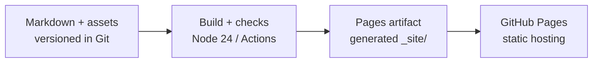

# Publication operations SOP

Architecture, configuration, build, deployment, monitoring and recovery procedures for The Way I AI.

The [operational readiness checklist](operational-readiness.md) provides per-project setup and acceptance steps. Keep account-setting snapshots and execution evidence in a private project record. GoatCounter and Cloudflare Web Analytics are the selected monitoring services; both remain uninstalled. Google Search Console verification also remains outstanding.

## Architecture



The site is a static publication at **https://thewayiai.com/**. There is no application server, database, account system or runtime rendering service. GitHub Actions builds and validates the publication, uploads a Pages artifact, and deploys that artifact. GitHub Pages does not require generated HTML in the repository.

| Component | Responsibility |
| --- | --- |
| `topics/`, `pages/`, `design-system/` | Authoritative articles, assets, collection metadata and presentation sources. |
| `scripts/` and the pinned npm lockfile | TypeScript generator, validation, image conversion and tests on Node.js 24. |
| `_site/` | Ignored, generated publication bundle. Never author or commit here. |
| `.github/workflows/pages.yml` | Validates PRs, uploads preview artifacts and deploys successful `main` builds. |
| GitHub Pages | Serves the uploaded static files over HTTPS on the apex domain. |
| Cloudflare DNS | Resolves the domain to GitHub Pages. Cloudflare Web Analytics does not require proxying or changing hosting. |

HTML carries complete article text. CSS, JavaScript, fonts, the search index and images are shared local files. Raster artwork has WebP variants from 320 to 1600 pixels, bounded by source size; navigation portraits are capped at 360 pixels. Search loads its index on demand. Content-addressed asset filenames allow reuse without stale asset collisions; GitHub Pages controls the response cache headers.

Downloaded bundles need the whole folder and a local HTTP server for full functionality. Generated site and preview HTML stay out of Git.

## Domain and hosting configuration

The canonical hostname is `thewayiai.com`, without `www`. Canonical page addresses end in `/`; internal HTML navigation uses relative, explicit `index.html` paths so a repository subpath or downloaded bundle retains native navigation.

Cloudflare is authoritative through `max.ns.cloudflare.com` and `tia.ns.cloudflare.com`. The apex currently has the four GitHub Pages IPv4 addresses:

```text
185.199.108.153
185.199.109.153
185.199.110.153
185.199.111.153
```

Keep the records DNS-only for the present architecture. There is no `www` record. Retain ownership-verification TXT records for GitHub and Google once configured. Obtain new verification values from the relevant account; they are not interchangeable. If changing Pages addresses, consult [GitHub's DNS instructions](https://docs.github.com/en/pages/configuring-a-custom-domain-for-your-github-pages-site/managing-a-custom-domain-for-your-github-pages-site).

In repository **Settings → Pages**, the publishing source is **GitHub Actions**, the custom domain is `thewayiai.com`, and **Enforce HTTPS** is enabled. The certificate covers the apex domain.

## GitHub operating controls

The repository's existing branch protection applies to `main`, includes administrators, requires linear history, and disallows force pushes and branch deletion. The `github-pages` deployment environment allows only the `main` branch. The default Actions token is read-only and cannot approve pull requests; only the deployment job requests `pages: write` and `id-token: write`.

Merge through a PR after the **build** job succeeds. Automatic enforcement of that check, fork-workflow approval for all external contributors, the Actions allowlist/SHA policy, and dependency/security reporting settings are tracked individually in the [GitHub readiness tasks](operational-readiness.md#github-settings).

Actions are pinned to full commit SHAs in source, with release comments for readability. The Pages-upload action also pins its nested upload action. Checkout does not persist credentials and does not fetch full history. `.github/dependabot.yml` defines weekly updates for Actions and npm; repository-level vulnerability alerts and security updates are separate settings.

For a solo maintainer, PRs and passing checks are still required operating practice. An independent human approval policy needs an available second reviewer: GitHub does not let an author approve their own PR. Record that policy explicitly rather than enabling a requirement that cannot be met. Do not require a successful production Pages deployment before merging: this workflow deploys only after a change reaches `main`.

## Local build and validation

Use Node.js 24. On a fresh checkout or lockfile change, install the exact dependency tree. Install Playwright Chromium before publication or browser tests:

```sh
npm ci
npx playwright install chromium
npm run typecheck
npm test
npm run build:site
npm run check
npm run test:browser
```

| Command | Result |
| --- | --- |
| `npm run build` | Generates `_site/` without rasterizing sharing JPEGs. |
| `npm run build:site` | Generates the full bundle, including sharing JPEGs; needs Chromium. |
| `npm run check` | Validates sources, links and references. If `_site/version.json` exists, also checks generated files against that recorded edition. It does not write output. |
| `npm run test:browser` | Builds the publication and background preview, then exercises both designs and their interactions. |
| `npm run preview` | Builds the full bundle and serves the current checkout locally, normally on port 4173. |

After editing while a preview is open, run `npm run build:site` and refresh. Inspect affected pages at desktop and 320/390px widths in light and dark modes. Check keyboard controls, full text, no-JavaScript content and relevant interactions. Generated output is staged only after source validation succeeds; do not repair a failed build by editing `_site/`.

A PR workflow uploads `site-preview-pr-N`, retained for 14 days and linked in the run summary. Download and unzip it, then serve that folder over HTTP, for example with `npx serve`. A PR preview does not deploy the public site.

## Deployment and post-deployment verification

1. Review the source diff and successful PR **build** check. Inspect the downloaded preview where presentation or behavior changed.
2. Merge the PR into `main`. Pushes to `main`, or manual dispatch of **Publish collection** on `main`, build and deploy through the `github-pages` environment. Local builds do not publish.
3. Confirm both **build** and **deploy** succeed in the [workflow run](https://github.com/tkarakai/the-way-i-ai/actions/workflows/pages.yml). Record its URL and resulting source revision in the private project record for a readiness rollout, or in the PR for routine changes.
4. Open the live homepage and a topic. Check `/version.json` against the deployed `main` revision and confirm the footer edition agrees. Allow for hosting caches when checking propagation.
5. Verify HTTPS, theme/design switching, search, images and a code example. Confirm an unknown nested path returns the generated 404 page with HTTP 404.
6. Check `/feed.xml`, `/sitemap.xml`, `/llms.txt`, `/llms-full.txt`, a topic's `index.md`, and `/.well-known/security.txt`. Check their content, not only an HTTP 200 response.
7. Where analytics have been activated, verify both services independently as described below. Finish only after recording any discrepancies and their follow-up.

Never deploy a PR preview artifact as production or manually alter the generated Pages files. The reviewed source and workflow remain the route to a reproducible deployment.

## Editions and incident traceability

A footer edition has the form `YYYY.MM.DD.HHMM+commit`, using UTC build date/time and the short source revision. Tracked local changes add `.local`. `/version.json` records the full revision and exact build timestamp. These describe the build, not the articles' publication dates.

For a bug report, collect the URL, edition, design/theme, browser/device, reproduction steps and relevant console/network errors. Check the matching workflow and source revision. There is currently no automatic production JavaScript-error collection.

To reproduce an edition, use the same sources, lockfile and Node/dependency versions. Set `SOURCE_DATE_EPOCH` to the recorded build timestamp in seconds and `GITHUB_SHA` to the recorded full revision. A `.local` edition also requires its uncommitted changes. Article dates come exclusively from front matter and never from the build clock or Git history.

## Monitoring and recurring checks

Current coverage consists of CI checks and manual live-site inspection. Analytics, search-console access and notification-delivery verification remain setup work in the readiness checklist. No unattended uptime checker or browser-error service is currently configured.

| Signal | Purpose and recurring use | Current integration state |
| --- | --- | --- |
| GitHub Actions | Build/test/deploy failures and the exact source revision behind a release. Review every deployment and failed run. | Workflow present; notification delivery still needs verification. |
| GoatCounter | Readership, popular pages and referrers. Review weekly after activation. | Selected; not installed. |
| Cloudflare Web Analytics | Real-user page-load performance and Core Web Vitals. Review weekly after activation, especially mobile performance. | Selected; not installed. |
| Google Search Console | Indexing errors, impressions, clicks and queries. Review monthly after verification. | Verification pending. |
| Manual live-site check | Availability, HTTPS/certificate, navigation, content, machine-readable files and displayed edition. | Run after deployments and weekly. |

Both analytics services observe the same publication. Use GoatCounter for readership and Cloudflare for performance; do not add their visitor/pageview counts together. Browser blocking and different measurement methods mean the totals may differ. Neither is an exact people count or an availability monitor. [Cloudflare Web Analytics](https://developers.cloudflare.com/web-analytics/about/) is client-side real-user monitoring, not a server request log.

The integration contract is: load analytics only on the production hostname; exclude local builds and PR previews; use canonical page paths without search queries/fragments for GoatCounter; verify Cloudflare's actual query transmission and retention before activation; retain the reader's URL and search behavior; and keep the page usable when either provider is blocked or unavailable. Test referrer handling for sensitive query strings too. Cloudflare documents that it does not log query strings; that is not proof that its beacon never transmits them. Record any behavior that cannot meet the accepted privacy contract before activation. Install the two snippets, narrow CSP allowances and privacy-page changes together. Never put administrative credentials in the site; provider-assigned public site identifiers belong in their documented client configuration.

For weekly operations, inspect the workflow/security inbox, review Dependabot PRs, run the manual site check, and review both analytics dashboards once active. For monthly operations, inspect search-indexing reports and the domain/certificate settings. Check `security.txt` expiry monthly and rebuild before it expires; the generated expiry is 180 days after the build. No automatic renewal schedule is configured.

Configure and verify delivery of Actions failures and security alerts to the maintainer's chosen inbox. GitHub's built-in Actions notifications cover runs the user triggers; do not assume they prove delivery for every other actor's run. See [workflow notifications](https://docs.github.com/en/actions/concepts/workflows-and-actions/notifications-for-workflow-runs). Record the test evidence before relying on them.

## Security and contact handling

The build rejects active Markdown HTML, dangerous/obfuscated URL schemes, unsafe SVG and source symlinks. A meta CSP hashes the pre-paint theme/design script and otherwise restricts scripts to approved sources. Existing inline styling remains supported. GitHub Pages does not expose arbitrary response headers; meta CSP cannot implement `frame-ancestors` or CSP reporting.

`/.well-known/security.txt` points to the [repository's Security page](https://github.com/tkarakai/the-way-i-ai/security) for contact and policy information. That page displays `SECURITY.md` from the default branch and provides **Report a vulnerability** for private reports. Reporting requires a GitHub account and sign-in. Review incoming reports through GitHub's private advisory workflow and keep report details private until coordinated disclosure. Use [public repository issues](https://github.com/tkarakai/the-way-i-ai/issues/new) only for non-sensitive feedback.

Every topic publishes complete Markdown alongside HTML; `llms.txt` indexes it and `llms-full.txt` combines topics. RSS includes full article content and preserves the original permalink GUIDs while using clean canonical links.

## Recovery

For a bad release, identify the faulty source change from `/version.json` and the Actions run. Revert that change through a normal PR, run the checks, then merge and let Actions deploy the corrected bundle. Verify the new edition and affected behavior. Do not force-push `main` or repair production by uploading hand-edited output.

If validation fails, correct the source or environment and rebuild. If deployment alone fails after a successful build, inspect the deploy logs, environment branch policy, Pages status and token permissions before retrying the failed job. A retry of an unchanged faulty source is not a content rollback. Preserve the run URL, failure and resolution in the PR or private project record.
